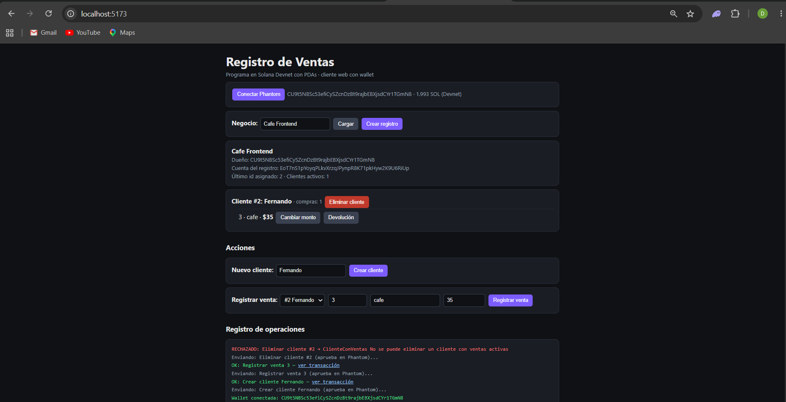
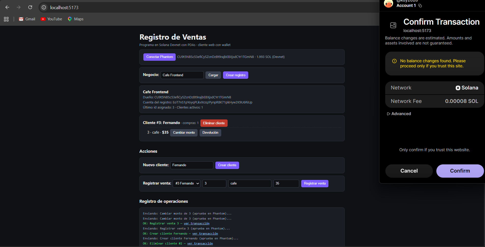
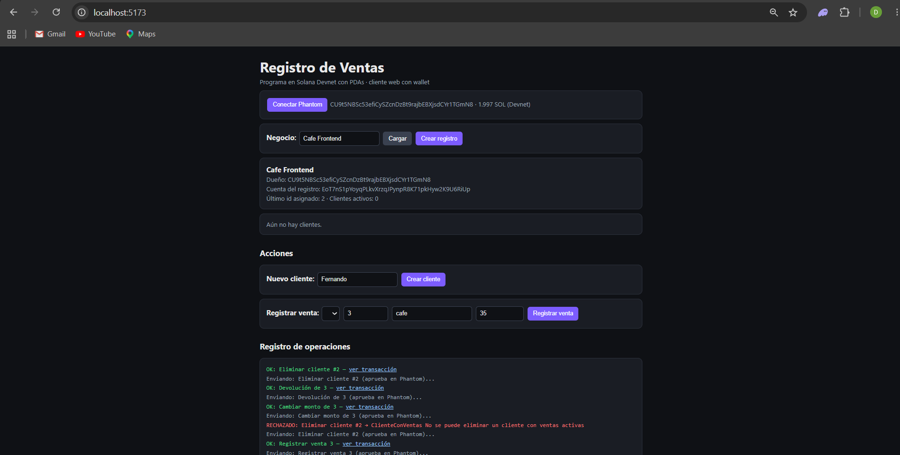

# Registro de Ventas en Solana con PDAs

Programa en Rust y Anchor que lleva el registro de ventas de un negocio, organizado por cliente. Cada registro, cliente y venta vive en su propia cuenta PDA.

**Program ID (Devnet):** `FXUhG74GQe6rCuWrMzowVoVnVRwd89DndfRV6JSESv7F`
[Ver en Solana Explorer](https://explorer.solana.com/address/FXUhG74GQe6rCuWrMzowVoVnVRwd89DndfRV6JSESv7F?cluster=devnet)

## Ruta elegida

Proyecto guiado con una mejora funcional.
Versión de partida: https://github.com/WayLearnLatam/Registro-Ventas-Solana-PDA

## Aporte propio

Sobre la base guiada (incluida la baja de cliente del día 5), añadí validaciones de negocio en Rust, cada una con su error propio:

- **Validación de monto:** `registrar_venta` y `cambiar_monto` rechazan montos en 0 (`MontoInvalido`).
- **Validación de datos:** nombre de negocio y de cliente (1 a 30 bytes), SKU (1 a 5 bytes) y descripción (1 a 50 bytes) se validan antes de guardar (`NombreInvalido`, `SkuInvalido`, `DescripcionInvalida`).
- **Límites de capacidad:** máximo 10 clientes por registro y 10 ventas por cliente (`LimiteClientes`, `LimiteVentas`), alineados con el espacio reservado en las cuentas.
- **Aritmética segura:** los contadores usan `checked_add` y devuelven `ContadorOverflow` en lugar de desbordarse.
- **Consistencia en devoluciones:** `hacer_devolucion` rechaza con `ComprasInconsistentes` si el contador de compras ya está en 0.

Todo está en `programs/registro_ventas_local/src/lib.rs`.

## Cómo comprobar el aporte

Ejecutar `node demo.cjs`. El paso 4 intenta registrar una venta con monto 0 y el programa la rechaza con `MontoInvalido`. El paso 6 intenta eliminar un cliente con ventas activas y se rechaza con `ClienteConVentas`. Ambos rechazos aparecen en la evidencia de abajo.

## Instrucciones del programa

| Instrucción | Qué hace |
|---|---|
| `crear_registro` | Crea el registro del negocio |
| `crear_cliente` | Crea un cliente y lo agrega al registro |
| `registrar_venta` | Crea una venta (SKU, descripción, monto) y la agrega al historial del cliente |
| `cambiar_monto` | Modifica el monto de una venta |
| `hacer_devolucion` | Quita la venta del historial, reduce las compras del cliente y cierra la cuenta de la venta |
| `eliminar_cliente` | Quita al cliente del registro y cierra su cuenta, solo si no tiene ventas activas |

## Reglas del programa

- Solo el `owner` del registro puede operar sobre él (`NoOwner`).
- Las PDAs de cliente y venta dependen de su cuenta padre, así que una venta solo se usa con su cliente.
- `ClienteConVentas`: no se puede eliminar un cliente con ventas activas.

## PDAs

| Cuenta | Seeds |
|---|---|
| Registro | `["registro", nombre_negocio, owner]` |
| Cliente | `["cliente", registro, id (u16, little-endian)]` |
| Venta | `["venta", cliente, sku]` |

## Frontend con wallet

Interfaz web en `frontend/` (Vite + `@anchor-lang/core` + Phantom) conectada al programa en Devnet. Cada operación se firma con la wallet y la página muestra los datos leídos de las cuentas Registro, Cliente y Venta, con el link de cada transacción al Explorer y los errores del programa.

Requisitos: extensión Phantom con Testnet Mode / Solana Devnet activado y algo de SOL de Devnet.

    cd frontend
    npm install
    npm run dev

Abrir http://localhost:5173, pulsar "Conectar Phantom" y usar los botones: crear registro, crear cliente, registrar venta, cambiar monto, devolución y eliminar cliente.

## Cómo ejecutarlo

Requisitos: Rust, Solana CLI, Anchor y Node.js, con una wallet en `~/.config/solana/id.json` con SOL de Devnet.

    anchor build
    anchor program deploy
    npm install
    node demo.cjs

El IDL está en `idl/registro.json`. El cliente es `demo.cjs` (basado en el IDL con `@anchor-lang/core`); también hay un cliente en `client/client.ts`.

## Evidencia de funcionamiento (Devnet)

`demo.cjs` ejecuta un flujo completo contra el programa desplegado:

| Paso | Resultado | Transacción |
|---|---|---|
| 1. Crear registro | OK | [ver](https://explorer.solana.com/tx/hPpcBB8H462Q1aFadQwVfZXbJnWzrrsZCnRSHwC1tTA7fZCZ9bf4Pp7ZjYbRarXY1YstnHFsPQ5J1X49pwSnxAd?cluster=devnet) |
| 2. Crear cliente "Ana" | OK | [ver](https://explorer.solana.com/tx/45MgMHKVinbPxxdGjsjFReumNYdeytZ7FipBBk7wYzamsMUffEQzG4nnGPnyQT6tWKDXaHRkU25poD8h6MB9SYsq?cluster=devnet) |
| 3. Registrar venta CAF01 por 50 | OK | [ver](https://explorer.solana.com/tx/46F6z3cXVoJxvtJzRc6GcMgiFbxwLfUGJ4yjwBJzxRqyJg9d8oTVvYtY31zB7RUgxPRjc4TCB3SaFdot9NjJvPzh?cluster=devnet) |
| 4. Venta con monto 0 | Rechazada: `MontoInvalido` | — |
| 5. Cambiar monto a 55 | OK | [ver](https://explorer.solana.com/tx/5EWHkTjoXFYj4i4ghAHhUXm9h61L6T8DzAovpaE37PCaY2LJy2tmj2ddTxi3Ms9dYpPmVYc8h9qL2zxjE8kib8PC?cluster=devnet) |
| 6. Eliminar cliente con ventas | Rechazada: `ClienteConVentas` | — |
| 7. Devolución de CAF01 | OK | [ver](https://explorer.solana.com/tx/5anmvBCy3gGBTWnRsrXgBqKw5VeY58iQiWPv719vgjmvGsLBtgdrdUGfktfyAdXD8F2t4g18V6fA8rGbHkLGhVKu?cluster=devnet) |
| 8. Eliminar cliente (sin ventas) | OK | [ver](https://explorer.solana.com/tx/4yZvW1CkEUdtUPxuxygZiJhWXU4TcpwceLfG7TWkjbqXWWqeVzD1zH99Kcf6zYo3zV9nYNgvAv5bmztWZaNjtoxa?cluster=devnet) |

Los pasos 4 y 6 son rechazos esperados y demuestran que las validaciones funcionan.